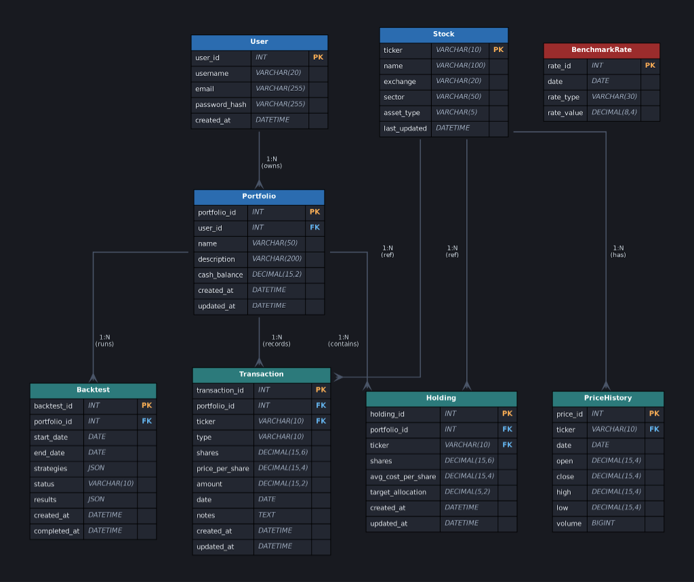
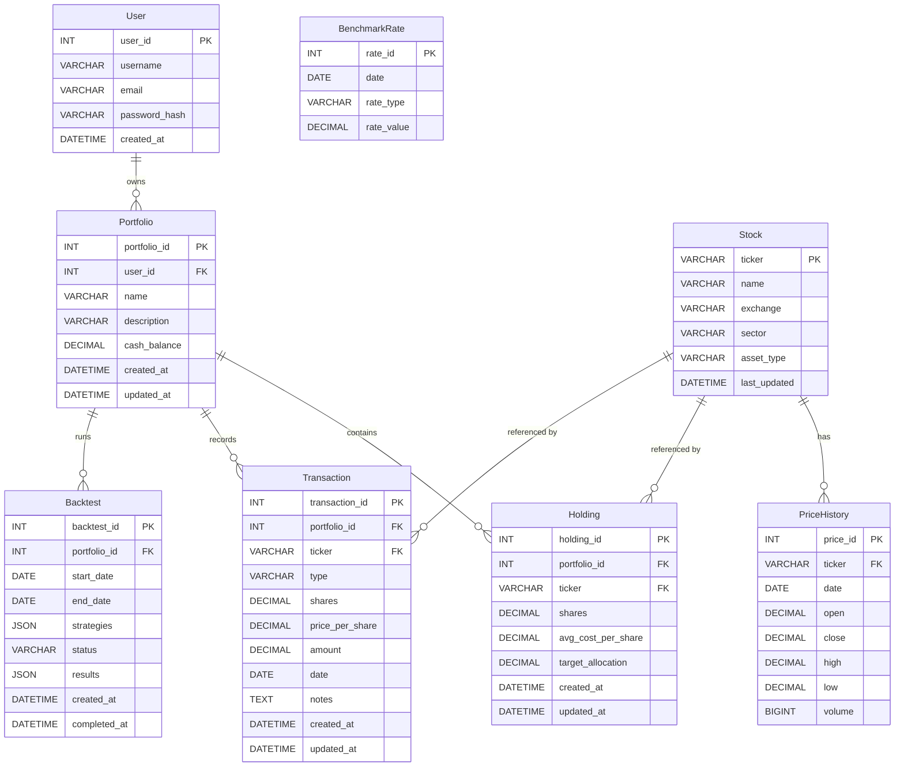

# Stage 2 — Conceptual and Logical Database Design

**Project:** Portfolio Rebalancing Strategy Simulator  
**Team:** fa26-cs411-team002-schema4  
**Course:** CS 411 — University of Illinois Urbana-Champaign

---

## Table of Contents

1. [ER Diagram](#1-er-diagram)
2. [Entity Assumptions](#2-entity-assumptions)
3. [Relationship Assumptions and Cardinality](#3-relationship-assumptions-and-cardinality)
4. [Normalization (BCNF)](#4-normalization-bcnf)
5. [Relational Schema](#5-relational-schema)

---

## 1. ER Diagram

We use an **Entity-Relationship Diagram (ERD)** to model the database.



### 1.1 Mermaid Diagram Code



> **Diagram Notes:**
> - `||--o{` means **one-to-many** (one side mandatory, many side optional zero or more)
> - `BenchmarkRate` has no foreign key — it is a standalone table sourced from the FRED API

---

## 2. Entity Assumptions

### 2.1 User
- **Why an entity?** A user is the core account holder of the system. All portfolio data is private to each user, so we need to track user identity, credentials, and creation time. A user is NOT simply an attribute of a portfolio because many portfolios can share the same user.
- **Key attributes:** `username` (unique display name), `email` (unique login identifier), `password_hash` (security).
- **Constraint:** `username` and `email` are both unique — no two accounts can share either.

### 2.2 Portfolio
- **Why an entity?** A portfolio is the central object of the application. It groups holdings, transactions, and backtest runs together. One user can own multiple portfolios (e.g., "Retirement", "Growth", "Dividend"), so Portfolio cannot just be an attribute of User.
- **Key attributes:** `cash_balance` tracks undeployed cash from deposits and withdrawals. `name` and `description` let users organize multiple portfolios.
- **Constraint:** Every portfolio must belong to exactly one user. A portfolio with no user is meaningless.

### 2.3 Stock
- **Why an entity?** A stock or ETF is an external financial instrument identified by its ticker symbol. It can appear in many portfolios and many transactions at the same time. Because the same stock (e.g., AAPL) is shared across all users, it must be its own entity rather than duplicated per holding or transaction.
- **Key attributes:** `ticker` is the natural unique identifier (e.g., "AAPL"). `asset_type` distinguishes individual stocks from ETFs, which have different rebalancing behaviors.
- **Data source:** Pre-loaded from the yfinance Python library.

### 2.4 PriceHistory
- **Why an entity?** Historical daily prices are a large, time-series dataset. One stock has hundreds of daily records spanning years. Storing this as a separate entity allows efficient date-range queries during backtesting. It cannot be an attribute of Stock because there is one price record per day per stock — a multivalued, time-dependent fact.
- **Key attributes:** `date`, `open`, `close`, `high`, `low`, `volume`. The pair `(ticker, date)` is unique.
- **Data source:** Pre-loaded from yfinance.

### 2.5 Holding
- **Why an entity?** A holding represents the ownership of a specific stock inside a specific portfolio. It acts as the resolution of a many-to-many relationship between Portfolio and Stock — one portfolio holds many stocks, and one stock can be held in many portfolios. Holding also stores user-defined `target_allocation` and the averaged purchase cost `avg_cost_per_share`, which are not attributes of either Portfolio or Stock alone.
- **Key attributes:** `shares`, `avg_cost_per_share`, `target_allocation`.
- **Constraint:** The pair `(portfolio_id, ticker)` is unique — a portfolio cannot hold the same stock twice in separate rows.

### 2.6 Transaction
- **Why an entity?** Transactions record every financial event in a portfolio: cash deposits, withdrawals, stock purchases, and stock sales. A transaction is its own event in time with a date, a type, and a dollar amount, so it cannot be collapsed into Holding or Portfolio as a simple attribute. It is also a critical input to the backtesting engine, which needs the full cash-flow history to compute XIRR.
- **Key attributes:** `type` (DEPOSIT, WITHDRAWAL, BUY, SELL), `amount`, `date`. For BUY/SELL, `ticker`, `shares`, and `price_per_share` are also stored.
- **Constraint:** `ticker` is NULL for DEPOSIT/WITHDRAWAL transactions (cash events have no stock).

### 2.7 Backtest
- **Why an entity?** A backtest is a simulation job that runs independently from live portfolio state. It has its own configuration (strategies, date range), execution status, and results. Because a user may run many backtests over different time periods on the same portfolio, and each result is a large JSON object, it must be its own entity. Storing backtest results as a column in Portfolio would violate normalization.
- **Key attributes:** `strategies` (JSON config), `status` (PENDING/RUNNING/DONE/FAILED), `results` (JSON output), `start_date`, `end_date`.

### 2.8 BenchmarkRate
- **Why an entity?** The FRED API provides historical risk-free interest rates (e.g., 10-year US Treasury yield) used as a benchmark comparison in backtest charts. This time-series data is independent of any portfolio or user — it is global market data. It cannot be an attribute of any other entity. It is modeled as a standalone entity with `(date, rate_type)` as the unique key.
- **Data source:** FRED API (Federal Reserve Economic Data).

---

## 3. Relationship Assumptions and Cardinality

### R1: User — Portfolio (`owns`)
- **Cardinality:** One-to-Many (1:N)
- **Description:** One user can own zero or more portfolios. Each portfolio belongs to exactly one user.
- **Why 1:N?** Users may want to separate investment strategies (e.g., a "Growth" portfolio and a "Dividend Income" portfolio). A portfolio cannot exist without an owner — it has no meaning without user context.
- **Implementation:** `portfolios.user_id` is a foreign key to `users.user_id`. Cascade delete ensures all portfolios are removed when a user account is deleted.

### R2: Portfolio — Holding (`contains`)
- **Cardinality:** One-to-Many (1:N)
- **Description:** One portfolio contains zero or more holdings. Each holding belongs to exactly one portfolio.
- **Why 1:N?** A portfolio can hold many different stocks/ETFs at the same time. A holding is meaningless without the portfolio it is part of.
- **Implementation:** `holdings.portfolio_id` FK. The `(portfolio_id, ticker)` unique constraint ensures no duplicate stock rows per portfolio.

### R3: Portfolio — Transaction (`records`)
- **Cardinality:** One-to-Many (1:N)
- **Description:** One portfolio records zero or more transactions. Each transaction belongs to exactly one portfolio.
- **Why 1:N?** A portfolio accumulates its entire history of deposits, withdrawals, buys, and sells over time. No transaction can belong to more than one portfolio at once.
- **Implementation:** `transactions.portfolio_id` FK.

### R4: Portfolio — Backtest (`runs`)
- **Cardinality:** One-to-Many (1:N)
- **Description:** One portfolio can have zero or more saved backtest runs. Each backtest belongs to exactly one portfolio.
- **Why 1:N?** Users may want to test different time periods or strategy combinations on the same portfolio and save each result. Backtests are not shared across portfolios.
- **Implementation:** `backtests.portfolio_id` FK.

### R5: Stock — PriceHistory (`has`)
- **Cardinality:** One-to-Many (1:N)
- **Description:** One stock has many daily price records. Each price record belongs to exactly one stock.
- **Why 1:N?** A stock trading for 10 years generates ~2,500 daily price records. These are time-series entries where each entry (ticker + date) maps to one set of OHLCV values.
- **Implementation:** `price_history.ticker` FK with `UNIQUE(ticker, date)` constraint.

### R6: Portfolio ↔ Stock via Holding (`holds`)
- **Cardinality:** Many-to-Many (M:N), resolved through the Holding entity
- **Description:** A portfolio can hold many different stocks. The same stock can be held in many different portfolios (e.g., many users may own AAPL).
- **Why M:N resolved as entity?** The Holding relationship itself carries meaningful data: `shares`, `avg_cost_per_share`, and `target_allocation` are attributes of the holding relationship — not of Portfolio or Stock alone. This justifies modeling Holding as a full entity rather than a simple join table.

### R7: Portfolio ↔ Stock via Transaction (`trades`)
- **Cardinality:** Many-to-Many (M:N), resolved through the Transaction entity
- **Description:** A portfolio can have many transactions involving many different stocks. The same stock can appear in transactions across many portfolios.
- **Why M:N resolved as entity?** Each transaction has its own `type`, `amount`, `date`, `shares`, and `price_per_share` — attributes that belong to the individual trading event, not to either Portfolio or Stock.

### R8: BenchmarkRate (no relationship)
- **Description:** BenchmarkRate is a standalone entity. It does not have a foreign key to any other entity. It represents global market data (risk-free rates from FRED) that is used as an optional comparison benchmark in the backtest results display.
- **Why no relationship?** Risk-free rates apply to all portfolios equally — they are not owned or controlled by any user or portfolio. Linking them via foreign key would be incorrect.

---

## 4. Normalization (BCNF)

We apply **Boyce-Codd Normal Form (BCNF)** to all tables. A table is in BCNF if and only if, for every non-trivial functional dependency X → Y, X is a superkey.

We first verify that all tables are in **1NF** and **3NF**, then confirm BCNF.

---

### 4.1 First Normal Form (1NF)
All tables satisfy 1NF because:
- Every column holds a single, atomic value (no repeating groups or arrays as column values)
- Every row is uniquely identified by a primary key
- *Note:* The `strategies` and `results` columns in `backtests` use the MySQL JSON type. This is a single atomic JSON blob — not a repeating group — so 1NF is not violated.

---

### 4.2 Second Normal Form (2NF)
A table is in 2NF if it is in 1NF and every non-key attribute is fully functionally dependent on the entire primary key (no partial dependencies).

All tables have **single-column primary keys** (INT AUTO_INCREMENT) except `stocks` (single-column VARCHAR PK). Because all PKs are single columns, **partial dependencies cannot exist**. All tables are automatically in 2NF.

---

### 4.3 Third Normal Form (3NF) and BCNF

We check each table for transitive dependencies (3NF) and verify that every FD has a superkey on the left (BCNF).

#### `users`
- FDs: `user_id → username, email, password_hash, created_at`
- `username → user_id` (because username is UNIQUE → it is a candidate key)
- `email → user_id` (because email is UNIQUE → it is a candidate key)
- All FDs have a superkey on the left-hand side. ✅ **BCNF**

#### `portfolios`
- FDs: `portfolio_id → user_id, name, description, cash_balance, created_at, updated_at`
- `user_id` is a FK, not a candidate key for this table — no FD `user_id → portfolio_id` holds (one user has many portfolios)
- Only FD determinant is `portfolio_id`, which is the PK (superkey). ✅ **BCNF**

#### `stocks`
- FDs: `ticker → name, exchange, sector, asset_type, last_updated`
- `ticker` is the PK and only determinant. ✅ **BCNF**

#### `price_history`
- FDs: `price_id → ticker, date, open, close, high, low, volume`
- Also: `(ticker, date) → open, close, high, low, volume` — the composite `(ticker, date)` is a candidate key (enforced by UNIQUE constraint)
- All FD determinants are superkeys. ✅ **BCNF**

#### `holdings`
- FDs: `holding_id → portfolio_id, ticker, shares, avg_cost_per_share, target_allocation, created_at, updated_at`
- Also: `(portfolio_id, ticker) → all attributes` — this composite is a candidate key (enforced by UNIQUE constraint)
- No transitive dependencies: `ticker` does not determine any holding-specific attributes (shares, target_allocation are specific to the holding, not to the stock).
- All FD determinants are superkeys. ✅ **BCNF**

#### `transactions`
- FDs: `transaction_id → portfolio_id, ticker, type, shares, price_per_share, amount, date, notes, created_at, updated_at`
- `ticker` appears here but does not determine any other transaction column (the same stock can have different prices, dates, amounts in different transactions).
- Only determinant is `transaction_id` (PK, superkey). ✅ **BCNF**

#### `backtests`
- FDs: `backtest_id → portfolio_id, start_date, end_date, strategies, status, results, created_at, completed_at`
- Only determinant is `backtest_id` (PK, superkey). ✅ **BCNF**

#### `benchmark_rates`
- FDs: `rate_id → date, rate_type, rate_value`
- Also: `(date, rate_type) → rate_value, rate_id` — the composite `(date, rate_type)` is a candidate key (enforced by UNIQUE constraint)
- No non-superkey determinant exists. ✅ **BCNF**

### Summary
All 8 tables are in **BCNF**. The key reasons are:
1. All primary keys are single-column surrogate keys (INT AUTO_INCREMENT) or single-column natural keys (ticker).
2. All non-key attributes depend only on the PK, with no transitive or partial dependencies.
3. Where composite unique keys exist (`price_history`, `holdings`, `benchmark_rates`), they are also candidate keys, so their FDs are valid under BCNF.

---

## 5. Relational Schema

The relational schema following the required format:

```
Table-Name(Column:Domain [PK/FK], ...)
```

---

```
User(
  user_id:INT [PK],
  username:VARCHAR(20),
  email:VARCHAR(255),
  password_hash:VARCHAR(255),
  created_at:DATETIME
)

Portfolio(
  portfolio_id:INT [PK],
  user_id:INT [FK to User.user_id],
  name:VARCHAR(50),
  description:VARCHAR(200),
  cash_balance:DECIMAL(15,2),
  created_at:DATETIME,
  updated_at:DATETIME
)

Stock(
  ticker:VARCHAR(10) [PK],
  name:VARCHAR(100),
  exchange:VARCHAR(20),
  sector:VARCHAR(50),
  asset_type:VARCHAR(5),
  last_updated:DATETIME
)

PriceHistory(
  price_id:INT [PK],
  ticker:VARCHAR(10) [FK to Stock.ticker],
  date:DATE,
  open:DECIMAL(15,4),
  close:DECIMAL(15,4),
  high:DECIMAL(15,4),
  low:DECIMAL(15,4),
  volume:BIGINT
)

Holding(
  holding_id:INT [PK],
  portfolio_id:INT [FK to Portfolio.portfolio_id],
  ticker:VARCHAR(10) [FK to Stock.ticker],
  shares:DECIMAL(15,6),
  avg_cost_per_share:DECIMAL(15,4),
  target_allocation:DECIMAL(5,2),
  created_at:DATETIME,
  updated_at:DATETIME
)

Transaction(
  transaction_id:INT [PK],
  portfolio_id:INT [FK to Portfolio.portfolio_id],
  ticker:VARCHAR(10) [FK to Stock.ticker],
  type:VARCHAR(10),
  shares:DECIMAL(15,6),
  price_per_share:DECIMAL(15,4),
  amount:DECIMAL(15,2),
  date:DATE,
  notes:TEXT,
  created_at:DATETIME,
  updated_at:DATETIME
)

Backtest(
  backtest_id:INT [PK],
  portfolio_id:INT [FK to Portfolio.portfolio_id],
  start_date:DATE,
  end_date:DATE,
  strategies:JSON,
  status:VARCHAR(10),
  results:JSON,
  created_at:DATETIME,
  completed_at:DATETIME
)

BenchmarkRate(
  rate_id:INT [PK],
  date:DATE,
  rate_type:VARCHAR(30),
  rate_value:DECIMAL(8,4)
)
```

---

### Relationship Summary Table

| Relationship | Type | FK Column | References |
|---|---|---|---|
| User → Portfolio | 1:N | `portfolios.user_id` | `users.user_id` |
| Portfolio → Holding | 1:N | `holdings.portfolio_id` | `portfolios.portfolio_id` |
| Portfolio → Transaction | 1:N | `transactions.portfolio_id` | `portfolios.portfolio_id` |
| Portfolio → Backtest | 1:N | `backtests.portfolio_id` | `portfolios.portfolio_id` |
| Stock → PriceHistory | 1:N | `price_history.ticker` | `stocks.ticker` |
| Portfolio ↔ Stock (via Holding) | M:N | both FKs in `holdings` | `portfolios`, `stocks` |
| Portfolio ↔ Stock (via Transaction) | M:N | both FKs in `transactions` | `portfolios`, `stocks` |
