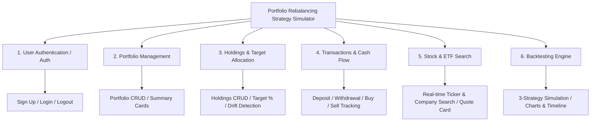

# 📊 Project Feature Specification & PM Guide

### (Portfolio Rebalancing Strategy Simulator — Comprehensive Overview)

> **Project Name:** Portfolio Rebalancing Strategy Simulator  
> **Course / Team:** CS 411 — fa26-cs411-team002-schema4  
> **Target Audience:** Product Managers (PM), Designers, Frontend/Backend Developers  
> **UI Reference:** Toss Securities style (Clean cards, large typography, Dark/Light mode support)

---

## 📌 Table of Contents

1. [Project Overview: What Are We Building & Why?](#1-project-overview-what-are-we-building--why)
2. [Total Feature Summary (6 Core Modules & 18 Sub-features)](#2-total-feature-summary-6-core-modules--18-sub-features)
3. [Overall Screen Architecture (Sitemap & Screen Map)](#3-overall-screen-architecture-sitemap--screen-map)
4. [Detailed Feature Breakdown (Rationale, Purpose, Screens, I/O)](#4-detailed-feature-breakdown-rationale-purpose-screens-io)
   - [Feature 1: User Authentication & Account Management (Auth)](#feature-1-user-authentication--account-management-auth)
   - [Feature 2: Portfolio Management](#feature-2-portfolio-management)
   - [Feature 3: Holdings & Target Allocation Management](#feature-3-holdings--target-allocation-management)
   - [Feature 4: Transaction History & Cash Flow Management](#feature-4-transaction-history--cash-flow-management)
   - [Feature 5: Stock & ETF Search](#feature-5-stock--etf-search)
   - [Feature 6: Rebalancing Backtesting Engine (Core Creative Feature)](#feature-6-rebalancing-backtesting-engine-core-creative-feature)
5. [Key Q&A (Why Isn't This Just a Simple Portfolio Tracker?)](#5-key-qa-why-isnt-this-just-a-simple-portfolio-tracker)

---

## 1. Project Overview: What Are We Building & Why?

### 💡 "Investors set target allocations, but market price changes distort them over time."

- Stocks that perform well grow disproportionately large, **increasing overall portfolio risk**.
- Underperforming stocks shrink in proportion, causing investors to **miss bargain re-entry opportunities**.
- Bringing these weights back to original target allocations is called **'Rebalancing'**.

### ❓ What is the Real Dilemma for Investors?

> _"Should I rebalance mechanically every month, or only when drift exceeds 5%?"_  
> _"Every time I sell assets to rebalance, I incur trading commissions and capital gains taxes. Can I instead use my monthly salary deposits to buy underweight assets first?"_

### 🎯 Core Mission of Our Product

Moving far beyond a passive portfolio tracker, our web application leverages **historical market price data (`yfinance`) and Federal Reserve risk-free rate data (`FRED`)** to:

1. Reflect the user’s actual portfolio assets and deposit/withdrawal history,
2. Simulate and backtest **three distinct rebalancing strategies** over identical historical market periods,
3. Present side-by-side comparisons of **final portfolio value, real return (XIRR), trade counts, portfolio turnover, and allocation drift**, serving as a **data-driven decision-making simulator**.

---

## 2. Total Feature Summary (6 Core Modules & 18 Sub-features)

The application consists of **6 high-level feature modules** and **18 granular sub-features**.

### 📋 Feature Matrix (CRUD & Detailed Breakdown)

|   #   | Feature Module                 | Sub-feature                                 |   CRUD Type   | Description                                                                              |
| :---: | ------------------------------ | ------------------------------------------- | :-----------: | ---------------------------------------------------------------------------------------- |
| **1** | **User Authentication (Auth)** | 1-1. Sign Up                                |    Create     | Register account with email, username, and bcrypt-hashed password                        |
|       |                                | 1-2. Login / Logout                         | Read / Delete | JWT token issuance and session clearance                                                 |
|       |                                | 1-3. Current User Profile                   |     Read      | Retrieve logged-in user profile (`/auth/me`)                                             |
| **2** | **Portfolio Management**       | 2-1. Create Portfolio                       |    Create     | Set portfolio name, optional description, and starting cash balance                      |
|       |                                | 2-2. List Portfolios                        |     Read      | View user's portfolio card grid                                                          |
|       |                                | 2-3. Portfolio Detail & Summary             |     Read      | Calculate total value, overall return, XIRR, and cash balance                            |
|       |                                | 2-4. Edit Portfolio                         |    Update     | Modify portfolio name and description                                                    |
|       |                                | 2-5. Delete Portfolio                       |    Delete     | Cascade delete portfolio and its related holdings, transactions, and backtests           |
| **3** | **Holdings & Allocation**      | 3-1. Add Holding                            |    Create     | Search ticker, set shares, average purchase cost, and target allocation (%)              |
|       |                                | 3-2. View Holdings & Drift                  |     Read      | Display market value, unrealized gain/loss, and target vs. current drift indicators      |
|       |                                | 3-3. Edit Holding                           |    Update     | Modify shares, average cost, or target allocation (%)                                    |
|       |                                | 3-4. Delete Holding                         |    Delete     | Remove specific holding from portfolio                                                   |
| **4** | **Transactions & Cash Flow**   | 4-1. Record Transaction                     |    Create     | Log Deposit (+), Withdrawal (-), Buy (Cash↓ Asset↑), Sell (Asset↓ Cash↑)                 |
|       |                                | 4-2. Transaction History & Filtering        |     Read      | Chronological table with type filters (Deposit/Withdrawal/Buy/Sell) and date ranges      |
|       |                                | 4-3. Edit Transaction                       |    Update     | Correct mistaken transaction amounts/dates and recalculate portfolio cash balance        |
|       |                                | 4-4. Delete Transaction                     |    Delete     | Revert transaction and roll back cash balance                                            |
| **5** | **Stock & ETF Search**         | 5-1. Real-time Search Auto-complete         | Read / Search | Case-insensitive search by ticker symbol or company name (min. 2 characters)             |
|       |                                | 5-2. Stock Detail View                      |     Read      | Popover/card showing latest close, 52-week high/low, exchange, and sector                |
| **6** | **Backtesting Engine**         | 6-1. Configure & Execute Backtest           |    Create     | Select historical timeframe (Start–End), configure 3 strategies, and run simulation      |
|       |                                | 6-2. Strategy Performance Comparison Report |     Read      | Final portfolio value, XIRR, turnover, drift, time-series charts, and rebalance timeline |
|       |                                | 6-3. Backtest History Management            | Read / Delete | View past simulation runs, check top-performing strategy, or delete past runs            |

---

## 3. Overall Screen Architecture (Sitemap & Screen Map)

User journeys revolve around **7 to 8 standalone pages (URL routes)** and **5 to 6 in-page modals**, designed with Toss-inspired minimalism and card layouts.

| Category             | Screen / View Name                | Route (URL)                             | Key Elements & Responsibilities                                                                                                                                                                                                                        |
| -------------------- | --------------------------------- | --------------------------------------- | ------------------------------------------------------------------------------------------------------------------------------------------------------------------------------------------------------------------------------------------------------ |
| **Auth**             | Login Page                        | `/login`                                | Centered minimal card form (Email, Password, Submit, link to Sign Up)                                                                                                                                                                                  |
|                      | Sign Up Page                      | `/signup`                               | Input validation form (Username, Email, Password, Confirm Password)                                                                                                                                                                                    |
| **Main**             | Dashboard / Portfolio List        | `/dashboard` or `/portfolios`           | Total net worth banner, portfolio card grid, "+ Create Portfolio" button                                                                                                                                                                               |
|                      | Create Portfolio Modal            | (Modal)                                 | Inputs for portfolio name, description, and initial cash balance                                                                                                                                                                                       |
| **Portfolio Detail** | Portfolio Detail Main View        | `/portfolios/:id`                       | 1) Top summary cards (Total Value, Total Return, XIRR, Cash Balance) 2) Allocation donut chart 3) Holdings table with drift status indicators 4) Recent transactions widget 5) Quick action buttons (+Holding, +Transaction, Run Backtest) |
|                      | Edit Portfolio Modal              | (Modal)                                 | Rename portfolio or update description                                                                                                                                                                                                                 |
|                      | Delete Portfolio Confirmation     | (Alert Modal)                           | Confirmation dialog warning that all child data will be permanently wiped                                                                                                                                                                              |
| **Holdings**         | Add Holding Modal                 | (Modal)                                 | Ticker auto-complete input + Shares + Average Cost + Target Allocation (%)                                                                                                                                                                             |
|                      | Edit Holding Modal                | (Modal)                                 | Modify shares, cost basis, or target allocation                                                                                                                                                                                                        |
|                      | Stock Detail Card                 | (Inline / Popover)                      | Displays 52-week high/low, sector, exchange, and latest closing price                                                                                                                                                                                  |
| **Transactions**     | Transaction History Page          | `/portfolios/:id/transactions`          | Full chronological table, type filter buttons (All/Deposit/Withdrawal/Buy/Sell), date filter                                                                                                                                                           |
|                      | Add Transaction 2-Step Modal      | (Modal)                                 | Step 1: Select Type (4 buttons) Step 2: Amount & Date (Cash) or Ticker, Shares, Price (Trade)                                                                                                                                                       |
|                      | Edit Transaction Modal            | (Modal)                                 | Correct mistaken transaction records                                                                                                                                                                                                                   |
| **Backtest**         | Backtest Setup Page               | `/portfolios/:id/backtest/new`          | Timeframe picker (Start–End), strategy selection toggles & threshold inputs, actual cash flow toggle                                                                                                                                                   |
|                      | Backtest Results Analysis Page    | `/portfolios/:id/backtest/:backtest_id` | 1) Summary metrics comparison table (Final Value, XIRR, Rebalances, etc.) 2) Time-series portfolio value chart (multi-line) 3) Allocation drift over time chart 4) Rebalance events chronological log                                         |
|                      | Backtest History List Page        | `/portfolios/:id/backtests`             | List of previously executed simulations, top-performing strategy badge, review/delete actions                                                                                                                                                          |
| **Search**           | Standalone Search Page (Optional) | `/search`                               | Global stock/ETF exploration search bar and directory cards                                                                                                                                                                                            |

---

## 4. Detailed Feature Breakdown (Rationale, Purpose, Screens, I/O)

---

### Feature 1: User Authentication & Account Management (Auth)

#### 1. Rationale & Business Purpose (Why?)

- **Rationale:** Financial assets and transaction records are strictly private and personal. Each user maintains distinct portfolios, cash balances, and custom backtest scenarios.
- **Purpose:** Ensure strict multi-tenant data isolation and protect user assets through secure JWT-based sessions, guaranteeing users access only their own records.

#### 2. User Scenario

> A new user signs up, logs in to receive a JWT access token, and is redirected to their personal portfolio dashboard.

#### 3. Screens Included

- **`/signup` (Sign Up Page):**
  - Minimal centered card layout.
  - Fields: Username, Email, Password, Confirm Password.
  - Live validation (min. 8 characters, email format check).
- **`/login` (Login Page):**
  - Email and password inputs, Submit button.
  - Generic error message on failure: _"Email or password is incorrect"_ (to prevent account enumeration).
- **Top Navigation Bar:**
  - User profile display, Dark/Light mode toggle switch, and Logout button.

#### 4. Data & Tech Integration

- Database table: `User` (`user_id`, `username`, `email`, `password_hash`).
- Password security: Salted one-way hashing with **bcrypt**.

---

### Feature 2: Portfolio Management

#### 1. Rationale & Business Purpose (Why?)

- **Rationale:** Investors rarely lump all money into one bucket. They compartmentalize capital by goal: "Retirement Pension (Conservative)", "Tech Growth (Aggressive)", or "Dividend Income".
- **Purpose:** Allow users to create independent portfolios, tracking total net worth, cumulative returns, and cash balances separately for each investment objective.

#### 2. User Scenario

> A user creates a new portfolio titled "US Growth 2026", inputs an initial cash deposit of $1,000, and navigates into its dedicated detail dashboard.

#### 3. Screens Included

- **`/portfolios` (Portfolio List / Dashboard):**
  - Top aggregate banner: Total net worth across all portfolios.
  - Card grid: Displays portfolio name, total valuation, cumulative return, holding count, and last updated timestamp.
  - Empty state: _"You don't have any portfolios yet. Create one to get started! [+ Create Portfolio]"_.
- **Create Portfolio Modal (`/portfolios/new`):**
  - Name (required, max 50 chars), Description (optional), Starting cash balance (default $0.00).
- **Portfolio Detail Page (`/portfolios/:id`):**
  - Top summary cards: Total Value (Holdings + Cash), Total Return (%), XIRR (%), Available Cash.
  - Unified view embedding the Holdings table, allocation chart, and recent transaction snippet.
- **Edit / Delete Modals:**
  - Edit: Rename and update description.
  - Delete: Warning dialog indicating all nested holdings, transactions, and backtest results will be permanently erased.

#### 4. Data & Tech Integration

- Database table: `Portfolio` (`portfolio_id`, `user_id`, `name`, `cash_balance`, etc.).
- Relational integrity: Configured with `ON DELETE CASCADE` to clean up child entities automatically.

---

### Feature 3: Holdings & Target Allocation Management

#### 1. Rationale & Business Purpose (Why?)

- **Rationale:** The foundation of portfolio rebalancing is knowing **"What do I currently hold?"** versus **"What is my target percentage?"**.
- **Purpose:**
  1. Continuously recalculate current asset allocations based on market movements.
  2. Compute **Allocation Drift (`Drift = Current % - Target %`)**.
  3. Visualize drift via color-coded status badges (Green/Yellow/Red) so users instantly know when an asset is overbought or underweight.

#### 2. User Scenario

> An investor holds 10 shares of Apple (AAPL) and 20 shares of VTI ETF, setting a target of 40% AAPL, 40% VTI, and 20% Cash. If Apple shares surge to represent 48% of the portfolio, the drift column flags `+8.0%` with a red warning badge.

#### 3. Screens Included

- **Holdings Table (inside `/portfolios/:id`):**
  - Columns: Ticker (e.g., AAPL), Company Name, Shares, Avg. Cost, Current Price, Market Value, Gain/Loss ($ / %), Current Allocation (%), **Target Allocation (%)**, **Drift (%)**.
  - **Drift Color System:**
    - 🟢 Green: Within ±2% (Healthy balance)
    - 🟡 Yellow: ±2% to ±5% (Moderate drift)
    - 🔴 Red: Exceeds ±5% (Rebalancing strongly recommended)
- **Add Holding Modal:**
  - Ticker auto-complete search input.
  - Shares, average cost per share, and target allocation percentage (0–100%).
  - Validation: Prevents duplicate tickers; warns if total target allocations across all assets exceed 100%.
- **Allocation Summary Bar & Donut Chart:**
  - Displays total allocated target % (e.g., 80%) and remaining unallocated cash target % (e.g., 20%).
  - Side-by-side comparison of target versus current asset breakdown.

#### 4. Data & Tech Integration

- Database table: `Holding` (`holding_id`, `portfolio_id`, `ticker`, `shares`, `avg_cost_per_share`, `target_allocation`).
- Current market prices are joined against pre-loaded `Stock` and `PriceHistory` tables.

---

### Feature 4: Transaction History & Cash Flow Management

#### 1. Rationale & Business Purpose (Why?)

- **Rationale:** Real-world investors don't just hold static assets; they contribute monthly savings (**Deposits**), make emergency withdrawals (**Withdrawals**), and execute **Buys** and **Sells**.
- **Purpose:**
  1. Accurately track liquid cash balances over time.
  2. Provide the essential timing data required to calculate **XIRR (Extended Internal Rate of Return)** rather than misleading simple returns.
  3. Form the foundational cash-flow dataset needed for the "Cash-Flow-Aware Rebalancing" strategy simulation.

#### 2. User Scenario

> On Jan 1, 2023, a user records a $5,000 deposit. On the same day, they record a buy transaction of 10 shares of AAPL at $130/share. The portfolio cash balance automatically adjusts from $5,000 down to $3,700.

#### 3. Screens Included

- **Transaction History Page (`/portfolios/:id/transactions`):**
  - Chronological table (Date, Type Badge, Ticker, Shares, Execution Price, Total Amount, Notes).
  - Filter buttons: All / Deposit / Withdrawal / Buy / Sell; date range picker.
  - Inline row actions: Edit and Delete.
- **Add Transaction 2-Step Modal:**
  - **Step 1:** Select Transaction Type (4 large buttons):
    - 🔵 Deposit / 🟠 Withdrawal / 🟢 Buy / 🔴 Sell
  - **Step 2-A (Deposit / Withdrawal):** Amount ($), Date, Notes.
    - Withdrawal validation: Cannot exceed available cash balance.
  - **Step 2-B (Buy / Sell):** Ticker search, Shares, Price per share ($), Date, Notes.
    - Buy validation: Warns if purchase cost exceeds cash balance.
    - Sell validation: Cannot sell more shares than currently owned.
- **Edit / Delete Modals:**
  - Correct mistakes and automatically recalculate portfolio cash balance.

#### 4. Data & Tech Integration

- Database table: `Transaction` (`transaction_id`, `portfolio_id`, `type`, `ticker`, `shares`, `price_per_share`, `amount`, `date`).
- Creates a transactional audit log that keeps `Portfolio.cash_balance` synchronized.

---

### Feature 5: Stock & ETF Search

#### 1. Rationale & Business Purpose (Why?)

- **Rationale:** Users do not always remember exact ticker symbols (e.g., whether Google is GOOG or GOOGL, or Vanguard Total World is VT).
- **Purpose:** Enable fast real-time search across ticker symbols and official company names with zero latency, lowering the barrier to entry for adding holdings.

#### 2. User Scenario

> A user types "micro" into the search field. The auto-complete dropdown immediately presents "MSFT — Microsoft Corp.", which they click to populate the form.

#### 3. Screens Included

- **Inline Real-time Auto-complete Dropdown:**
  - Built into both the "Add Holding" and "Record Buy Transaction" modals.
  - Triggers after 2 characters typed.
- **Stock Detail Card (Popover / View):**
  - Displays company name, ticker, exchange (NASDAQ/NYSE), sector, latest closing price, and 52-week high/low.
- **Standalone Search Directory (`/search`, Optional):**
  - Dedicated exploration view to browse supported stocks and ETFs.

#### 4. Data & Tech Integration

- Database tables: `Stock` (`ticker`, `name`, `exchange`, `sector`, `asset_type`) and `PriceHistory`.
- Pre-populated with S&P 500 equities and major index ETFs via `yfinance`, enabling fast sub-10ms local SQL queries.

---

### Feature 6: Rebalancing Backtesting Engine (Core Creative Feature)

#### 1. Rationale & Business Purpose (Why?)

- **Rationale:** This is the **flagship creative differentiator** of our application.
- **Purpose:** Provide users with empirical, data-driven proof of how three distinct rebalancing strategies would have performed under identical historical market conditions and cash-flow patterns.

#### 2. The Three Strategies Explained

1. **Threshold-Based Rebalancing:**
   - _Rule:_ Evaluates daily closing prices. Whenever any holding drifts beyond a user-defined threshold (e.g., ±5%), a rebalance is triggered immediately.
   - _Pros:_ Asset allocation stays strictly close to targets.
   - _Cons:_ Can trigger excessive trading during volatile sideways markets, racking up friction and fees.
2. **Calendar-Based Rebalancing:**
   - _Rule:_ Rebalances mechanically on a fixed schedule (monthly, quarterly, or annually) regardless of drift.
   - _Pros:_ Predictable, disciplined, low maintenance.
   - _Cons:_ Ignores interim market swings; can leave severe drift uncorrected for months.
3. **Cash-Flow-Aware / Hybrid Rebalancing (Our Key Innovation):**
   - _Rule:_ When new cash deposits arrive, the engine **prioritizes allocating cash toward underweight assets first**. It only sells overweight assets if deposit routing alone is insufficient to bring drift within the threshold.
   - _Pros:_ Drastically reduces forced asset sales, **minimizing trading commissions and taxable events**.

#### 3. Screens Included

- **Backtest Setup Page (`/portfolios/:id/backtest/new`):**
  - Timeframe selector: Start Date to End Date.
  - Strategy selection toggles & parameters:
    - [x] Threshold-Based (Drift % input, e.g., 5%)
    - [x] Calendar-Based (Frequency dropdown: Monthly / Quarterly / Yearly)
    - [x] Cash-Flow-Aware / Hybrid (Drift % input, e.g., 5%)
  - Assumptions: Toggle to incorporate actual historical deposits/withdrawals, trade commission fee ($).
  - Prominent "Run Backtest" button with loading state.
- **Backtest Results Analysis Page (`/portfolios/:id/backtest/:backtest_id`):**
  - **A. Summary Comparison Table:** Side-by-side comparison across all active strategies:
    - Final Portfolio Value ($)
    - Total Cumulative Return (%)
    - **XIRR (%)** (Annualized dollar-weighted return)
    - Total Rebalance Count
    - Portfolio Turnover (%)
    - Average & Maximum Allocation Drift (%)
  - **B. Portfolio Value Over Time Chart:** Multi-line graph comparing strategy equity curves over time with optional S&P 500 / FRED risk-free benchmark lines.
  - **C. Allocation Drift Over Time Chart:** Graph tracking portfolio deviation from target percentages.
  - **D. Rebalance Events Timeline Log:** Detailed audit log showing exact execution dates, trigger reasons (e.g., _"AAPL drifted +6.2%"_), and traded assets.
- **Backtest History List (`/portfolios/:id/backtests`):**
  - Archive of past backtests, timeframe summary, top-performing strategy badge, review, and delete actions.

#### 4. Data & Tech Integration

- Database table: `Backtest` (`backtest_id`, `portfolio_id`, `start_date`, `end_date`, `strategies`, `status`, `results` stored as structured JSON).
- The backtesting engine pulls historical daily prices from `PriceHistory` and runs simulation algorithms in Python, writing comprehensive time-series metrics back to MySQL.

---

## 5. Key Q&A (Why Isn't This Just a Simple Portfolio Tracker?)

### Q1. "How does our product differ from Toss Securities or typical portfolio apps?"

> **Answer:**  
> Standard portfolio trackers only tell users: **"What is my portfolio worth right now?"**  
> Our platform answers the strategic question: **"If I had followed different rebalancing rules in the past, how much more money would I have made, and how much would I have saved in trading friction?"**

### Q2. "Why is recording deposits/withdrawals (Transactions) and computing XIRR so critical?"

> **Answer:**  
> Academic backtests typically assume a single lump-sum investment at the beginning. In real life, however, retail investors contribute funds periodically (e.g., monthly salary savings).  
> In accounts with ongoing deposits and withdrawals, simple return calculations `(Current Value - Cost Basis) / Cost Basis` produce heavily distorted results. **XIRR (Extended Internal Rate of Return)** is mandatory to evaluate true dollar-weighted performance. Furthermore, real deposit timing is required to evaluate our **Cash-Flow-Aware Hybrid Strategy**, which uses incoming deposits to rebalance without selling assets.

---
