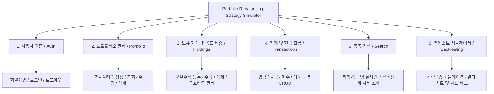

# 📊 프로젝트 기능 정의 및 PM 가이드 문서

### (Portfolio Rebalancing Strategy Simulator — Korean Feature Specification)

> **프로젝트명:** Portfolio Rebalancing Strategy Simulator (포트폴리오 리밸런싱 전략 시뮬레이터)  
> **과목 / 팀:** CS 411 — fa26-cs411-team002-schema4  
> **문서 대상:** 기획자(PM), 디자이너, 프론트엔드/백엔드 개발자  
> **UI 레퍼런스:** 토스증권 (Toss Securities 스타일 — 깔끔한 카드, 큰 숫자, 다크/라이트 모드 지원)

---

## 📌 목차

1. [프로젝트 개요: 우리는 무엇을, 왜 만드는가?](#1-프로젝트-개요-우리는-무엇을-왜-만드는가)
2. [총 기능 요약 (대기능 6가지 & 세부 기능 18가지)](#2-총-기능-요약-대기능-6가지--세부-기능-18가지)
3. [화면 구성 총괄 (Sitemap & Screen Map)](#3-화면-구성-총괄-sitemap--screen-map)
4. [기능별 상세 분석 (구현 이유, 목적, 포함 화면, I/O)](#4-기능별-상세-분석-구현-이유-목적-포함-화면-io)
   - [기능 1: 사용자 인증 및 계정 관리 (Auth)](#기능-1-사용자-인증-및-계정-관리-auth)
   - [기능 2: 포트폴리오 관리 (Portfolio Management)](#기능-2-포트폴리오-관리-portfolio-management)
   - [기능 3: 보유 자산 및 목표 비중 관리 (Holdings & Allocation)](#기능-3-보유-자산-및-목표-비중-관리-holdings--allocation)
   - [기능 4: 거래 내역 및 현금 흐름 관리 (Transactions & Cash Flow)](#기능-4-거래-내역-및-현금-흐름-관리-transactions--cash-flow)
   - [기능 5: 종목 및 ETF 검색 (Search)](#기능-5-종목-및-etf-검색-search)
   - [기능 6: 리밸런싱 백테스트 시뮬레이션 엔진 (Backtesting — 핵심 킬러 기능)](#기능-6-리밸런싱-백테스트-시뮬레이션-엔진-backtesting--핵심-킬러-기능)
5. [핵심 질문 Q&A (왜 단순 포트폴리오 앱이 아닌가?)](#5-핵심-질문-qa)

---

## 1. 프로젝트 개요: 우리는 무엇을, 왜 만드는가?

### 💡 "투자자들은 목표 비중(Asset Allocation)을 세우지만, 시간이 지나면 주가가 변해 비중이 망가집니다."

- 주가가 오른 주식은 포트폴리오 내 비중이 너무 커져 **위험(Risk)이 커지고**,
- 떨어진 주식은 비중이 줄어 **저가 매수의 기회**를 놓치게 됩니다.
- 이를 원래 계획한 비중으로 맞춰주는 작업을 **‘리밸런싱(Rebalancing)’**이라고 합니다.

### ❓ 그렇다면 투자자들의 진짜 고민은 무엇일까요?

> _"1달마다 정기적으로 리밸런싱을 해야 할까? 아니면 5% 이상 틀어졌을 때만 해야 할까?"_  
> _"리밸런싱할 때마다 주식을 팔면 매매 수수료나 세금이 나가는데, 차라리 매달 들어오는 월급(입금액)으로 부족한 주식만 사서 맞추면 어떨까?"_

### 🎯 우리 프로덕트의 핵심 미션

우리의 웹 앱은 단순한 자산 기록장을 넘어, **과거 실제 주가 데이터(yfinance)와 미국 연준 무위험 금리 데이터(FRED)**를 기반으로:

1. 사용자의 실제 보유 종목과 현금 입출금 이력을 반영하고,
2. **3가지 서로 다른 리밸런싱 전략**을 동일한 과거 기간에 시뮬레이션(백테스팅)하여,
3. **최종 자산 가치, 수익률(XIRR), 거래 횟수, 회전율, 괴리율(Drift)**을 나란히 비교해 줌으로써 **"어떤 전략이 나에게 가장 유리했는지"**를 데이터로 입증해 주는 **시뮬레이션 기반 의사결정 대시보드**입니다.

---

## 2. 총 기능 요약 (대기능 6가지 & 세부 기능 18가지)

이 프로젝트는 **총 6개의 핵심 모듈(기능 그룹)**과 **18개의 세부 기능**으로 구성되어 있습니다.

### 📋 기능 매트릭스 표 (CRUD 및 세부 기능)

| 번호  | 대분류 기능 모듈                    | 세부 기능 (Feature)                 | 동작 유형 (CRUD) | 설명                                                             |
| :---: | ----------------------------------- | ----------------------------------- | :--------------: | ---------------------------------------------------------------- |
| **1** | **사용자 인증 (Auth)**              | 1-1. 회원가입                       |      Create      | 이메일, 유저네임, 비밀번호(Bcrypt)로 계정 생성                   |
|       |                                     | 1-2. 로그인 / 로그아웃              |  Read / Delete   | JWT 발급 및 세션 만료 처리                                       |
|       |                                     | 1-3. 내 정보 조회                   |       Read       | 현재 로그인 유저 프로필 조회 (`/auth/me`)                        |
| **2** | **포트폴리오 관리 (Portfolio)**     | 2-1. 포트폴리오 생성                |      Create      | 새 포트폴리오 이름, 설명, 시작 현금 설정                         |
|       |                                     | 2-2. 포트폴리오 목록 조회           |       Read       | 사용자가 가진 포트폴리오 카드 그리드 조회                        |
|       |                                     | 2-3. 포트폴리오 상세 요약           |       Read       | 총 자산, 누적 수익률, XIRR, 현금 잔고 계산 조회                  |
|       |                                     | 2-4. 포트폴리오 수정                |      Update      | 포트폴리오 이름 및 설명 변경                                     |
|       |                                     | 2-5. 포트폴리오 삭제                |      Delete      | 포트폴리오 및 하위 데이터(종목/거래/결과) 연쇄 삭제              |
| **3** | **보유자산 및 비중 (Holdings)**     | 3-1. 보유 자산 추가                 |      Create      | 티커 검색 후 수량, 평단가, 목표 비중(%) 등록                     |
|       |                                     | 3-2. 보유 자산 목록 및 괴리율 조회  |       Read       | 현재가 반영 평가금액, 손익, 목표 비중 대비 괴리율(Drift) 조회    |
|       |                                     | 3-3. 보유 자산 수정                 |      Update      | 수량, 평단가, 목표 비중(%) 수정                                  |
|       |                                     | 3-4. 보유 자산 삭제                 |      Delete      | 특정 종목 포트폴리오에서 제거                                    |
| **4** | **거래 및 현금흐름 (Transactions)** | 4-1. 입출금 및 매매 등록            |      Create      | 입금(+), 출금(-), 매수(현금↓주식↑), 매도(주식↓현금↑) 기록        |
|       |                                     | 4-2. 거래 내역 조회 및 필터링       |       Read       | 날짜순 정렬, 유형별(입/출/매수/매도) 필터 조회                   |
|       |                                     | 4-3. 거래 내역 수정                 |      Update      | 잘못 입력한 거래 금액/수량/일자 수정 및 현금 잔고 재계산         |
|       |                                     | 4-4. 거래 내역 삭제                 |      Delete      | 거래 취소 및 잔고 롤백                                           |
| **5** | **종목 및 ETF 검색 (Search)**       | 5-1. 실시간 자동완성 검색           |  Read / Search   | 티커 또는 회사명으로 DB 내 주식/ETF 검색 (2글자 이상)            |
|       |                                     | 5-2. 종목 간이 상세 조회            |       Read       | 전일 종가, 52주 최고/최저가 등 팝업 확인                         |
| **6** | **백테스트 엔진 (Backtesting)**     | 6-1. 백테스트 파라미터 설정 및 실행 |      Create      | 기간(Start-End), 3대 전략 파라미터 선택 후 시뮬레이션 구동       |
|       |                                     | 6-2. 전략별 성과 비교 리포트        |       Read       | 최종 자산, XIRR, 회전율, 괴리율, 차트(자산변화/괴리율), 타임라인 |
|       |                                     | 6-3. 백테스트 실행 이력 관리        |  Read / Delete   | 과거 실행한 시뮬레이션 히스토리 열람 및 삭제                     |

---

## 3. 화면 구성 총괄 (Sitemap & Screen Map)

사용자가 경험하게 되는 **화면(Page), 모달(Modal), 주요 컴포넌트 뷰(View)** 목록입니다. 토스증권의 미니멀리즘과 카드 기반 레이아웃을 따릅니다.

| 화면 구분           | 화면/뷰 명칭               | 라우트 (URL)                            | 주요 화면 구성 및 역할                                                                                                                                                                                           |
| ------------------- | -------------------------- | --------------------------------------- | ---------------------------------------------------------------------------------------------------------------------------------------------------------------------------------------------------------------- |
| **인증 화면**       | 로그인 화면                | `/login`                                | 미니멀 카드 폼 (이메일, 비밀번호, 로그인 버튼, 회원가입 링크)                                                                                                                                                    |
|                     | 회원가입 화면              | `/signup`                               | 입력 유효성 검사 폼 (유저네임, 이메일, 비밀번호, 확인)                                                                                                                                                           |
| **메인 화면**       | 대시보드 / 포트폴리오 목록 | `/dashboard` 또는 `/portfolios`         | 전체 자산 요약 배너, 포트폴리오 카드 그리드, '+ 포트폴리오 만들기' 버튼                                                                                                                                          |
|                     | 포트폴리오 생성 모달       | (모달 팝업)                             | 포트폴리오 이름, 설명, 초기 입금액 입력 폼                                                                                                                                                                       |
| **포트폴리오 상세** | 포트폴리오 상세 메인 화면  | `/portfolios/:id`                       | 1) 상단 자산 요약 카드 (총자산, 수익률, XIRR, 현금잔고) 2) 자산 배분 도넛 차트 3) 보유 종목 테이블(괴리율 신호등 표시) 4) 최근 거래 내역 위젯 5) 빠른 실행 액션 버튼 (+종목, +거래, 시뮬레이션 실행) |
|                     | 포트폴리오 수정 모달       | (모달 팝업)                             | 이름 및 설명 수정                                                                                                                                                                                                |
|                     | 포트폴리오 삭제 확인 팝업  | (경고 모달)                             | "정말 삭제하시겠습니까?" 경고 및 연쇄 삭제 확인                                                                                                                                                                  |
| **보유 종목 관련**  | 보유 종목 추가 모달        | (모달 팝업)                             | 종목 검색 인풋 + 수량 + 평단가 + 목표 비중(%) 입력 폼                                                                                                                                                            |
|                     | 보유 종목 수정 모달        | (모달 팝업)                             | 수량, 평단가, 목표 비중 변경 폼                                                                                                                                                                                  |
|                     | 종목 상세 정보 카드        | (인라인/팝업)                           | 선택한 종목의 52주 고/저가, 섹터, 최신 종가 표시                                                                                                                                                                 |
| **거래 내역 관련**  | 거래 내역 전체 목록 화면   | `/portfolios/:id/transactions`          | 전체 거래 히스토리 테이블, 유형별 필터(입금/출금/매수/매도), 날짜 필터                                                                                                                                           |
|                     | 거래 추가 2단계 모달       | (모달 팝업)                             | 1단계: 유형 선택(4개 버튼) 2단계: 금액/날짜(입출금) 또는 종목검색/수량/단가(매매)                                                                                                                             |
|                     | 거래 수정 모달             | (모달 팝업)                             | 오입력 수정 및 저장                                                                                                                                                                                              |
| **백테스트 관련**   | 백테스트 설정 화면         | `/portfolios/:id/backtest/new`          | 시뮬레이션 기간(Start-End) 선택, 3가지 전략 활성화 토글 및 임계치 설정, 실제 입출금 반영 여부 토글                                                                                                               |
|                     | 백테스트 결과 분석 화면    | `/portfolios/:id/backtest/:backtest_id` | 1) 요약 비교 테이블 (최종자산, XIRR, 리밸런싱 횟수 등) 2) 시계열 자산가치 비교 꺾은선 차트 3) 자산 괴리율 추이 차트 4) 리밸런싱 이벤트 타임라인 로그                                                    |
|                     | 백테스트 히스토리 목록     | `/portfolios/:id/backtests`             | 이전에 돌려본 백테스트 목록 및 최고 수익률 전략 요약, 삭제 액션                                                                                                                                                  |
| **공통 탐색**       | 종목 검색 화면 (선택형)    | `/search`                               | 상단 검색창 + 인기 종목/ETF 카드 리스트                                                                                                                                                                          |

---

## 4. 기능별 상세 분석 (구현 이유, 목적, 포함 화면, I/O)

PM으로서 각 기능의 **"Why(왜 필요한가?)"**, **"What(무엇을 하는가?)"**, **"How it looks(어떤 화면인가?)"**를 완벽하게 파악할 수 있도록 상세히 설명합니다.

---

### 기능 1: 사용자 인증 및 계정 관리 (Auth)

#### 1. 구현 이유와 비즈니스 목적 (Why?)

- **이유:** 금융 자산 데이터는 개인화된 민감 데이터입니다. 사용자마다 포트폴리오 구성, 보유 자산, 거래 이력, 백테스트 결과가 제각각입니다.
- **목적:** 모든 데이터의 소유권(Ownership)을 사용자별로 완벽히 격리(Multi-tenancy)하고, 안전한 JWT 토큰 기반 세션을 제공하여 본인 자산만 열람·수정할 수 있도록 보호합니다.

#### 2. 사용자 시나리오 (User Scenario)

> 사용자는 서비스를 처음 방문해 회원가입을 하고, 로그인하여 토큰을 발급받은 뒤 대시보드로 이동합니다.

#### 3. 포함되는 화면 (Screens)

- **`/signup` (회원가입 화면):**
  - 깔끔한 중앙 카드 레이아웃.
  - 입력 필드: 사용자명(Username), 이메일(Email), 비밀번호, 비밀번호 확인.
  - 실시간 유효성 검사 (비밀번호 8자 이상, 이메일 형식 확인).
- **`/login` (로그인 화면):**
  - 이메일, 비밀번호 입력 및 '로그인' 버튼.
  - 로그인 실패 시 보안을 위해 "이메일 또는 비밀번호가 일치하지 않습니다" 단일 메시지 표시.
- **네비게이션 상단 바:**
  - 사용자 이름 표시, 다크/라이트 모드 스위치, 로그아웃 버튼.

#### 4. 데이터 및 기술 연계

- DB의 `User` 테이블(`user_id`, `username`, `email`, `password_hash`).
- 비밀번호는 **bcrypt** 단방향 해싱 암호화 저장.

---

### 기능 2: 포트폴리오 관리 (Portfolio Management)

#### 1. 구현 이유와 비즈니스 목적 (Why?)

- **이유:** 실전 투자자는 하나의 계좌만 굴리지 않습니다. "은퇴 연금 포트폴리오(안정형)", "미국 빅테크 모으기(공격형)", "배당주 포트폴리오(인컴형)" 등 투자 목적에 따라 바구니(Portfolio)를 따로 관리합니다.
- **목적:** 사용자가 다수의 독립된 포트폴리오를 만들고, 각 포트폴리오별로 총 자산 규모, 누적 손익, 현금 잔고를 분리하여 한눈에 관리할 수 있게 합니다.

#### 2. 사용자 시나리오 (User Scenario)

> 사용자가 '미국 성장주 2026'이라는 포트폴리오를 새로 만들고, 초기 예수금 $1,000를 입력한 뒤 포트폴리오 상세 화면으로 들어갑니다.

#### 3. 포함되는 화면 (Screens)

- **`/portfolios` (포트폴리오 목록 / 대시보드):**
  - 상단: 모든 포트폴리오를 합친 총 자산 배너.
  - 하단: 카드 그리드(각 카드마다 포트폴리오 이름, 총 평가액, 누적 수익률, 종목 수, 최근 업데이트 일시 표시).
  - 카드 클릭 시 상세 페이지 이동 / '+ 새 포트폴리오' 버튼.
  - 데이터가 없을 때: "아직 등록된 포트폴리오가 없습니다. 첫 포트폴리오를 만들어보세요!" 빈 화면(Empty State) 가이드.
- **포트폴리오 생성 모달 (`/portfolios/new`):**
  - 포트폴리오 이름(필수, 최대 50자), 설명(선택), 초기 현금 잔고(기본값 $0).
- **포트폴리오 상세 화면 (`/portfolios/:id`):**
  - 상단 대형 숫자 카드: 총 자산 가치(주식 평가액 + 현금), 총 수익률, XIRR, 보유 현금(Cash).
  - 하단 탭 또는 분할 뷰로 [보유 종목 테이블], [비중 차트], [최근 거래]를 한눈에 노출.
- **포트폴리오 수정/삭제 모달:**
  - 수정: 이름 및 메모 변경.
  - 삭제: 자식 데이터(보유종목, 거래, 백테스트)가 모두 지워짐을 안내하는 강한 경고 모달.

#### 4. 데이터 및 기술 연계

- DB의 `Portfolio` 테이블 (`portfolio_id`, `user_id`, `name`, `cash_balance` 등).
- 삭제 시 `ON DELETE CASCADE`로 연관 하위 데이터 일괄 정합성 유지.

---

### 기능 3: 보유 자산 및 목표 비중 관리 (Holdings & Target Allocation)

#### 1. 구현 이유와 비즈니스 목적 (Why?)

- **이유:** 리밸런싱의 시작은 **"내가 무엇을 가지고 있는가?"**와 **"내가 원래 원했던 이상적인 비율(Target %)은 얼마인가?"**를 아는 것입니다.
- **목적:**
  1. 실제 주가 변동에 따라 변하는 현재 비중(Current %)을 실시간 계산하고,
  2. 사용자가 설정한 목표 비중(Target %)과의 차이인 **'괴리율(Drift = Current - Target)'**을 시각적 신호등(Green/Yellow/Red)으로 보여주어,
  3. 지금 어떤 종목이 너무 과열되었고 어떤 종목이 덜 샀는지를 즉각 인지하게 돕습니다.

#### 2. 사용자 시나리오 (User Scenario)

> 사용자가 애플(AAPL) 10주(평단 $150, 목표 비중 40%), VTI ETF 20주(평단 $200, 목표 비중 40%)를 등록합니다. 남은 20%는 현금 목표 비중으로 둡니다. 애플 주가가 급등하여 비중이 48%가 되자 괴리율(+8%) 컬럼에 빨간 불이 들어옵니다.

#### 3. 포함되는 화면 (Screens)

- **보유 종목 테이블 (Holdings Table — 포트폴리오 상세 내부):**
  - 컬럼: 티커(AAPL), 종목명, 보유수량, 매수평단가, 현재가, 평가금액, 평가손익($ / %), 현재 비중(%), **목표 비중(%)**, **괴리율(Drift %)**.
  - **괴리율 색상 시스템:**
    - 🟢 녹색: ±2% 이내 (정상 범위)
    - 🟡 노란색: ±2% ~ ±5% (주의 범위)
    - 🔴 빨간색: ±5% 초과 (리밸런싱 시급!)
- **보유 종목 추가 모달 (`Add Holding Modal`):**
  - 종목 검색 인풋 (티커 자동완성).
  - 보유 주식 수, 주당 매수 평균 단가, 목표 비중(0~100%).
  - 검증: 기존 포트폴리오 내 중복 종목 등록 방지, 목표 비중 합산이 100%를 초과할 경우 경고.
- **목표 비중 현황 요약 바 & 도넛 차트 (Allocation Summary View):**
  - 전체 설정 비중 합계(예: 80%)와 미배분 현금 비중(예: 20%) 표시.
  - 목표 비중 vs 현재 실제 비중을 비교하는 이중 도넛/파이 차트.

#### 4. 데이터 및 기술 연계

- DB의 `Holding` 테이블 (`holding_id`, `portfolio_id`, `ticker`, `shares`, `avg_cost_per_share`, `target_allocation`).
- 현재가는 `Stock` 및 `PriceHistory` 최신 종가와 조인하여 실시간 산출.

---

### 기능 4: 거래 내역 및 현금 흐름 관리 (Transactions & Cash Flow)

#### 1. 구현 이유와 비즈니스 목적 (Why?)

- **이유:** 다른 단순 포트폴리오 사이트들은 그냥 종목 수량만 바꿉니다. 하지만 실제 투자자는 **월급날 돈을 넣고(Deposit), 급전이 필요하면 출금(Withdrawal)하며, 주식을 매수(Buy)하거나 매도(Sell)**합니다.
- **목적:**
  1. 입출금과 매매에 따른 실제 **'현금 잔고(Cash Balance)'**를 정확하게 추적합니다.
  2. 단순 수익률이 아닌, 현금 유출입 시점과 규모를 반영한 진짜 실질 수익률인 **XIRR(내부수익률)**을 산출할 수 있습니다.
  3. 백테스트 시뮬레이션 시 "신규 입금된 돈으로 부족한 종목을 먼저 사서 리밸런싱을 해결하는 스마트 전략"을 돌릴 수 있는 필수 밑거름이 됩니다.

#### 2. 사용자 시나리오 (User Scenario)

> 2023년 1월 1일 $5,000를 입금(Deposit)하고, 같은 날 AAPL 10주를 주당 $130에 매수(Buy)합니다. 현금 잔고는 $5,000에서 $1,300이 차감되어 $3,700이 됩니다.

#### 3. 포함되는 화면 (Screens)

- **전체 거래 내역 화면 (`/portfolios/:id/transactions`):**
  - 최신순 정렬 테이블 (거래일자, 유형 뱃지, 티커, 체결수량, 단가, 총 거래금액, 메모).
  - 필터: 전체 / 입금 / 출금 / 매수 / 매도 버튼 토글, 날짜 기간 검색.
  - 각 행마다 수정 / 삭제 버튼.
- **거래 추가 모달 (`Add Transaction Modal`):**
  - **1단계: 거래 유형 선택 버튼 4개**
    - 🔵 입금 (Deposit) / 🟠 출금 (Withdrawal) / 🟢 매수 (Buy) / 🔴 매도 (Sell)
  - **2단계-A (입금/출금 선택 시):**
    - 금액($), 거래 일자, 메모.
    - 출금 시 현재 현금 잔고 초과 불가 유효성 검사.
  - **2단계-B (매수/매도 선택 시):**
    - 종목 검색, 체결 수량, 주당 체결 가격, 일자, 메모.
    - 매수 시: 총 결제금액(수량×가격)이 현금 잔고를 초과할 경우 경고/차감.
    - 매도 시: 현재 보유 수량을 초과하여 팔 수 없도록 차단.

#### 4. 데이터 및 기술 연계

- DB의 `Transaction` 테이블 (`transaction_id`, `portfolio_id`, `type`, `ticker`, `shares`, `price_per_share`, `amount`, `date`).
- 거래 생성/수정/삭제 시 `Portfolio.cash_balance`가 트랜잭션 단위로 정확히 동기화.

---

### 기능 5: 종목 및 ETF 검색 (Search)

#### 1. 구현 이유와 비즈니스 목적 (Why?)

- **이유:** 사용자가 "애플을 담고 싶은데 티커가 APPL인가 AAPL인가?", "미국 전체 시장 ETF 티커가 뭐더라?" 하고 헷갈릴 수 있습니다.
- **목적:** 2글자 이상 입력 시 티커(Ticker)와 회사명(Company Name)을 실시간으로 검색하여 오탈자 없이 정확한 금융 상품을 선택할 수 있도록 돕습니다.

#### 2. 사용자 시나리오 (User Scenario)

> 사용자가 보유종목 추가창에서 "micro"라고 검색하면 "MSFT - Microsoft Corp."가 드롭다운으로 뜨고, 이를 클릭하면 바로 선택됩니다.

#### 3. 포함되는 화면 (Screens)

- **인라인 실시간 검색 드롭다운 (Inline Auto-complete Dropdown):**
  - [보유 종목 추가] 및 [매수 거래 추가] 모달 내에 내장된 검색창.
  - 타이핑 시 하단에 매칭되는 종목 리스트 즉시 렌더링.
- **종목 상세 요약 팝업 (Stock Detail View):**
  - 검색된 종목을 클릭했을 때 나타나는 간이 정보 카드:
  - 티커, 회사명, 상장 거래소(NASDAQ/NYSE), 섹터(Tech, Health 등), 최신 종가, 52주 최고가/최저가.
- **독립 종목 검색 페이지 (`/search`, 옵션):**
  - 서비스에서 지원하는 수천 개의 주식/ETF 목록을 둘러보고 탐색하는 화면.

#### 4. 데이터 및 기술 연계

- DB의 `Stock` 테이블(`ticker`, `name`, `exchange`, `sector`, `asset_type`) 및 `PriceHistory`.
- `yfinance` 파이썬 라이브러리를 통해 주요 S&P 500 및 인기 ETF의 과거 3~5년치 일봉 데이터가 DB에 사전 적재(Pre-loaded)되어 있어 네트워크 딜레이 없이 10ms 이내 초고속 조회.

---

### 기능 6: 리밸런싱 백테스트 시뮬레이션 엔진 (Backtesting — 핵심 킬러 기능)

#### 1. 구현 이유와 비즈니스 목적 (Why?)

- **이유:** 이것이 바로 **우리 프로젝트가 단순한 포트폴리오 가계부와 완전히 차별화되는 지점(Creative Component)**입니다!
- **목적:** 과거 특정 기간(예: 2021년~2023년의 대폭락장과 반등장) 동안 **"내가 설정한 포트폴리오를 서로 다른 3가지 리밸런싱 규칙으로 운영했다면 결과가 어떻게 달라졌을까?"**를 가상 시뮬레이션하여 비교해 줍니다.

#### 2. 비교 대상 3대 전략 상세 설명

1. **임계치 기준 리밸런싱 (Threshold-Based):**
   - _규칙:_ 매일 주가를 확인하다가 어떤 종목이라도 목표 비중에서 설정한 오차(예: 5%)를 벗어나면 즉시 리밸런싱을 실행.
   - _장점:_ 자산 배분이 항상 목표에 가깝게 유지됨.
   - _단점:_ 주가가 요동칠 때 거래가 너무 잦아져 매매 수수료가 많이 발생할 수 있음.
2. **캘린더 정기 리밸런싱 (Calendar-Based):**
   - _규칙:_ 괴리율과 상관없이 정해진 주기(매월 첫 영업일, 매분기, 매년)가 오면 기계적으로 목표 비중으로 복원.
   - _장점:_ 관리가 단순하고 거래 횟수가 예측 가능함.
   - _단점:_ 분기 사이에 특정 주식이 폭락/폭등해도 방치될 수 있음.
3. **현금 흐름 반영 하이브리드 리밸런싱 (Cash-Flow-Aware / Hybrid - 창의적 차별점!):**
   - _규칙:_ 신규 입금(월급 적립 등)이 발생했을 때, 기존 주식을 무작정 팔지 않고 **비중이 미달된(Underweight) 자산을 먼저 매수**하는 데 입금액을 투입함. 그래도 비중이 안 맞춰질 때만 초과 자산을 매도함.
   - _장점:_ 주식을 강제로 매도할 필요성을 줄여 **거래 수수료와 세금을 극적으로 절감**함.

#### 3. 포함되는 화면 (Screens)

- **백테스트 설정 화면 (`/portfolios/:id/backtest/new`):**
  - **기간 선택:** 시작일(Start Date) ~ 종료일(End Date) 캘린더 피커.
  - **비교할 전략 선택:**
    - [x] 임계치 전략 (임계치 입력: 예 5%)
    - [x] 정기 캘린더 전략 (주기 선택: 월별/분기별/연별)
    - [x] 현금 흐름 하이브리드 전략 (임계치 입력: 예 5%)
  - **가정 설정:** 실제 입출금 이력 반영 여부(Toggle), 거래당 수수료($0 등).
  - '백테스트 실행 (Run Backtest)' 대형 버튼 (클릭 시 로딩 스피너 작동).
- **백테스트 종합 결과 리포트 (`/portfolios/:id/backtest/:backtest_id`):**
  - **A. 3대 전략 핵심 성과 지표 비교 테이블 (Summary Table):**
    - 최종 포트폴리오 가치 (Final Value)
    - 누적 수익률 (Total Return %)
    - 시간가중 실질 수익률 (**XIRR %**)
    - 총 리밸런싱 실행 횟수 (Number of Rebalances)
    - 포트폴리오 회전율 (Portfolio Turnover %)
    - 평균 및 최대 괴리율 (Avg / Max Allocation Drift %)
  - **B. 시계열 자산 가치 변화 차트 (Portfolio Value Over Time):**
    - Recharts 기반 다중 선 그래프 (전략 1은 파란선, 전략 2는 녹색선, 전략 3은 보라선).
    - 옵션: S&P 500 지수 또는 FRED 무위험 금리 벤치마크 선 비교.
    - 호버 시 툴팁으로 특정 날짜의 각 전략 자산가치 노출.
  - **C. 자산 괴리율 추이 차트 (Allocation Drift Over Time):**
    - 시간이 지남에 따라 목표 비중에서 얼마나 벗어났는지를 시각화.
  - **D. 리밸런싱 이벤트 타임라인 로그 (Rebalance Events Timeline):**
    - 몇 년 몇 월 며칠에 어떤 이유(Trigger Reason: 예: AAPL +6.2% 이탈)로 어떤 자산을 사고팔았는지 타임라인 리스트 제공.
- **백테스트 이력 화면 (`/portfolios/:id/backtests`):**
  - 과거에 실행했던 시뮬레이션 목록, 실행일자, 설정 기간, 1등 전략 요약, 다시보기/삭제 기능.

#### 4. 데이터 및 기술 연계

- DB의 `Backtest` 테이블(`backtest_id`, `portfolio_id`, `strategies`, `status`, `results` JSON 컬럼).
- `PriceHistory`에서 해당 기간의 일별 종가 데이터를 일괄 로딩하여 메모리 상에서 시뮬레이션 계산 후 JSON 포맷으로 결과 고속 영구 보관.

---

## 5. 핵심 질문 Q&A

### Q1. "우리가 일반적인 토스증권이나 포트폴리오 트래커와 다른 점이 무엇인가요?"

> **답변:**  
> 일반 앱은 **"지금 내 주식이 얼마인가?"**만 보여줍니다.  
> 우리 앱은 **"과거에 서로 다른 리밸런싱 규칙을 썼다면 내 돈이 얼마나 더 불어났고 수수료를 얼마나 아낄 수 있었는가?"**를 시뮬레이션해 주는 **전략 분석 엔진**입니다.

### Q2. "왜 복잡하게 입출금(Transaction)과 XIRR까지 계산해야 하나요?"

> **답변:**  
> 일반적인 단순 백테스트는 처음에 $10,000를 한 번에 넣고 끝납니다. 하지만 대다수의 2030 직장인은 매달 50만 원씩 적립식으로 투자합니다.  
> 입출금이 빈번한 계좌는 단순 수익률((현재가-원금)/원금)로 측정하면 왜곡이 심합니다. 따라서 시점별 현금 흐름을 반영하는 **XIRR(확장 내부수익률)**이 필수적이며, 적립식 매수를 리밸런싱에 활용하는 **'현금흐름 하이브리드 전략'**을 검증하기 위해서도 거래 내역이 반드시 필요합니다.

---
